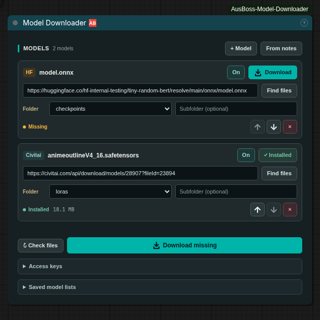
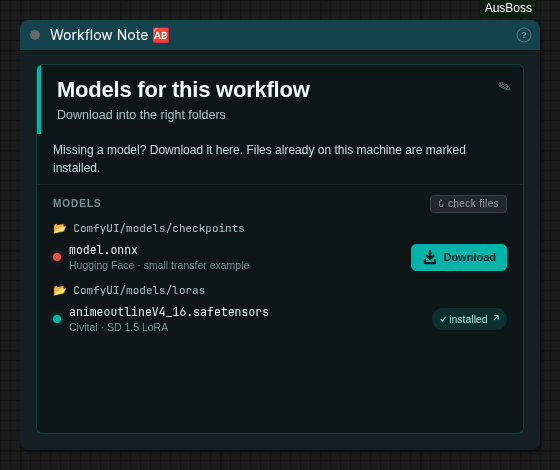

<div align="center">
  <h1>AusBoss Model Downloader</h1>
  <p>Keep the model links in your workflow. Download the files straight into ComfyUI.</p>
  <p>
    <a href="https://github.com/ausboss/ComfyUI-AusBoss-Model-Downloader/actions/workflows/checks.yml"></a>
    <a href="LICENSE"></a>
    <a href="https://github.com/ausboss/ComfyUI-AusBoss"></a>
  </p>
  <p><a href="#install">Install</a> · <a href="#download-your-first-model">Quick start</a> · <a href="#works-with-workflow-notes">Workflow Notes</a> · <a href="#troubleshooting">Troubleshooting</a></p>
</div>

Paste a **Civitai** or **Hugging Face** link, choose the model folder, and click **Download**. Files already on your machine show as **Installed**, so you can see what a workflow is missing before you run it.

This is a separate addon for [ComfyUI-AusBoss](https://github.com/ausboss/ComfyUI-AusBoss). The downloader node works on its own; installing the main pack also adds direct downloads to its **Workflow Note** model rows.

<p align="center"></p>

**Initial public version, 0.1.0.** Tested with real downloads on Linux in both Classic and Nodes 2.0. Registry availability depends on review; the Git and ZIP installation methods below work independently. The Registry package ID is `ausboss-model-downloader`.

## What it does

- **Downloads to the right place.** Choose a registered model folder and an optional subfolder, such as `loras/style/anime`.
- **Finds existing models.** Checks the selected model type's registered folders, including extra model paths and nested folders.
- **Lets you choose the file.** Hugging Face repository links open a list of supported model files; Civitai model and version links work too.
- **Keeps the list with the workflow.** Links, folders, and enabled rows travel with the saved workflow. Access keys stay on the ComfyUI machine.
- **Shows progress and supports cancellation.** Downloads run one at a time in the background. Opening or running a workflow never starts a download automatically.
- **Supports reusable lists.** Save named lists, import/export JSON, and reorder rows with the arrows.

## Install

You need a working local or hosted ComfyUI installation where you can install custom nodes. There are **no extra Python packages to install** for this addon; it uses ComfyUI's existing dependencies.

### With Git

1. Stop ComfyUI.
2. Open a terminal in your **`ComfyUI/custom_nodes`** folder.
3. Run:

   ```bash
   git clone https://github.com/ausboss/ComfyUI-AusBoss-Model-Downloader.git
   ```

4. Start ComfyUI again and refresh the browser.
5. Double-click the canvas and search for **Model Downloader**. Add **Model Downloader 🆎**.

**Windows Portable:** the folder is `ComfyUI_windows_portable\ComfyUI\custom_nodes`. Open a terminal there and use the same command. On Linux or a hosted pod, use the `custom_nodes` folder inside the ComfyUI installation you launch.

For Workflow Note integration, install [ComfyUI-AusBoss](https://github.com/ausboss/ComfyUI-AusBoss#install) alongside this addon and restart ComfyUI. The note adapter was tested with **ComfyUI-AusBoss 2.21.1**.

### Without Git

1. [Download the ZIP](https://github.com/ausboss/ComfyUI-AusBoss-Model-Downloader/archive/refs/heads/main.zip), or use **Code → Download ZIP** above.
2. Extract it and rename the extracted folder to `ComfyUI-AusBoss-Model-Downloader`.
3. Put that folder in `ComfyUI/custom_nodes`.
4. Restart ComfyUI and refresh the browser.

Check the folder layout—there should be only one addon folder around `__init__.py`:

```text
ComfyUI/
└── custom_nodes/
    └── ComfyUI-AusBoss-Model-Downloader/
        ├── __init__.py
        ├── downloader/
        └── js/
```

For help locating your installation, see [ComfyUI's custom-node installation guide](https://docs.comfy.org/installation/install_custom_node).

## Download your first model

1. Add **Model Downloader 🆎** and click **+ Model**.
2. Paste a Civitai model/download URL or a Hugging Face repository/file URL. Click **Find files** if needed, then choose a file when a picker appears.
3. Choose its **Folder**. Add a subfolder if you want one. Check that the destination matches the model's instructions.
4. Click **Download** on that row, or **Download missing** to queue the enabled rows.
5. Wait for **Installed**, then select the model in the appropriate loader node.

No connections or **Run** click are needed for the downloader. Downloads are started by its buttons.

| Control | What it means |
| --- | --- |
| **On / Off** | Include or skip this row when using **Download missing**. An Off row can still be downloaded individually. |
| **Check files** | Refresh installed/missing status across the registered folders. |
| **From notes** | Collect model links and destinations from AusBoss Workflow Notes in this workflow. |
| **↑ / ↓** | Move a row earlier or later in the list. |
| **×** | Remove a row from the list. The model file stays on disk. |
| **Cancel** | Stop an active/queued transfer and remove its partial file. |

## Works with Workflow Notes

With **ComfyUI-AusBoss** installed, put a supported model URL and its destination folder in a **Workflow Note** model row. The addon checks whether the file exists and turns the row's download link into an in-app download button. Once the download finishes, the note refreshes its installed state.

<p align="center"></p>

This works even when there is no Model Downloader node on the canvas. Use **From notes** when you want a central list and a **Download missing** button. Links to other websites and sample media keep their normal browser behavior.

On a fresh pod, open the saved workflow, add your access keys if required, and download the missing models. The workflow carries the model list, not your credentials.

## Access keys and saved lists

Open **Access keys** to enter a Civitai API key or Hugging Face token. Click **Save** next to each field. For gated models, your account must also have accepted the provider's model-access terms. Public models may work without a key.

- Keys are stored locally under ComfyUI's protected user-data directory, separately for each ComfyUI user profile.
- Keys are never included in workflow files, exported lists, or API responses. The UI only reports whether a key is saved.
- Each provider receives only its own key. Authorization is not forwarded to storage redirects.
- Enter keys again on a new machine or pod; use the **Clear** buttons to remove saved keys.

**Saved model lists** contains named presets and JSON import/export. Import replaces the node's current list. Export includes model links and destination settings only.

## Updates and removal

For a Git install, open a terminal in `ComfyUI/custom_nodes/ComfyUI-AusBoss-Model-Downloader` and run:

```bash
git pull --ff-only
```

Restart ComfyUI and refresh the browser. For a ZIP install, stop ComfyUI and replace the addon folder with the new extracted copy; keep only one copy installed.

To uninstall, stop ComfyUI and remove this addon's folder from `custom_nodes`. Downloaded models remain in their model folders. Clear saved access keys in the node first if you also want to remove them.

## Troubleshooting

| Problem | What to check |
| --- | --- |
| Node does not appear | Check the folder layout above, restart ComfyUI, and refresh the browser. Look for `IMPORT FAILED` in ComfyUI's startup log. |
| Access required / HTTP 401 or 403 | Save the correct provider key under **Access keys** and accept any gated-model terms on the provider's website. |
| More than one file in a repository | Select the desired file in the picker before downloading. |
| Model is in a different folder | Choose the right model type and click **Check files**. Only that type's registered roots are searched. |
| Workflow Note still opens a website | The row needs a Civitai/Hugging Face model URL and a recognized model folder. Update the main pack and restart ComfyUI. |
| Transfer failed | Check free space, write permissions, the source link, and the network connection. The destination filesystem must support hard links for the final no-overwrite save. |
| Old styling after an update | Restart ComfyUI and hard-refresh the browser. |

Need help? [Open an issue](https://github.com/ausboss/ComfyUI-AusBoss-Model-Downloader/issues) with your ComfyUI version, operating system, and the error message. Do not include access keys or signed download URLs.

## Download rules and tested scope

The server accepts model files only: `.safetensors`, `.gguf`, `.ckpt`, `.pt`, `.bin`, `.pth`, `.onnx`, and `.sft`. Destinations must be registered ComfyUI model folders. Code folders, absolute paths, parent traversal, and paths escaping a model root are refused. This addon does not load or execute downloaded models.

**Installed means a matching filename exists.** Existing files are never overwritten and are not rehashed. New downloads are checked against provider size and SHA256 metadata when available. Incomplete transfers are not shown as installed models. Download only models you trust.

Tested with **ComfyUI 0.44.0**, frontend **1.58.5**, and **ComfyUI-AusBoss 2.21.1** on Linux: real Civitai and Hugging Face transfers, Workflow Note downloads, saved-workflow reload, Classic and Nodes 2.0, resizing, and cancellation/integrity tests. The small files in the screenshots are transfer examples, not a complete generation workflow.

Windows/macOS runtime behavior and real gated/private-model credentials have not yet been exercised. Downloads do not resume across a ComfyUI restart. The Workflow Note adapter depends on the main pack's note panel and should be rechecked after updates. As with other custom-node routes, protect access to your ComfyUI server; user profiles alone do not provide server authentication.

See [CONTRIBUTING.md](CONTRIBUTING.md) for tests and [shared component provenance](docs/shared-components.md) for the UI source. [MIT licensed](LICENSE).
